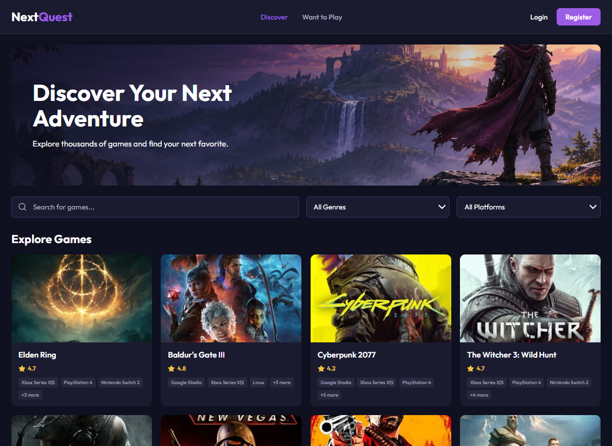
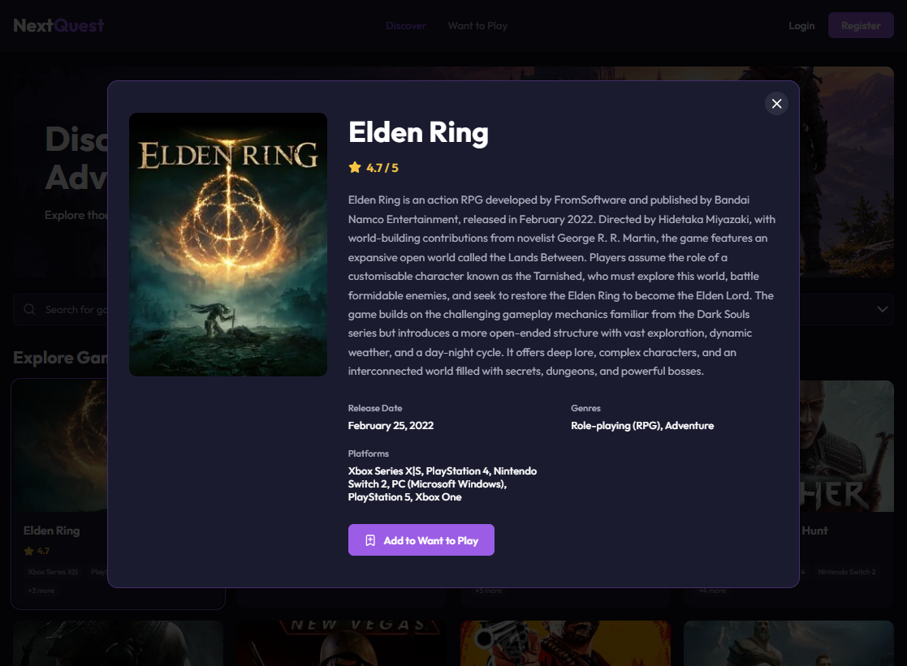
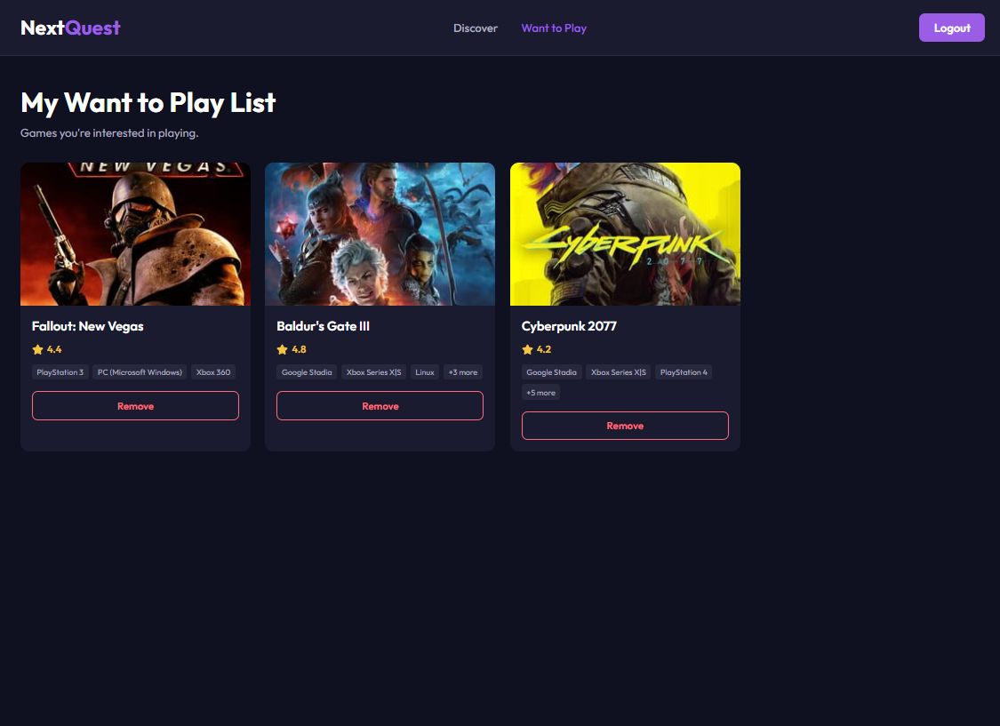
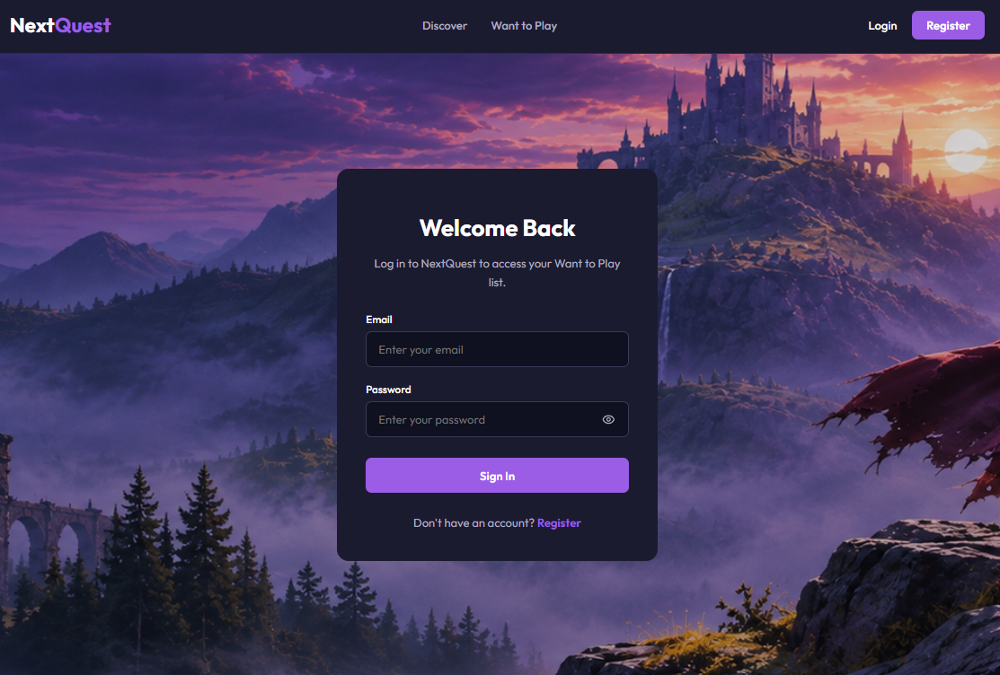
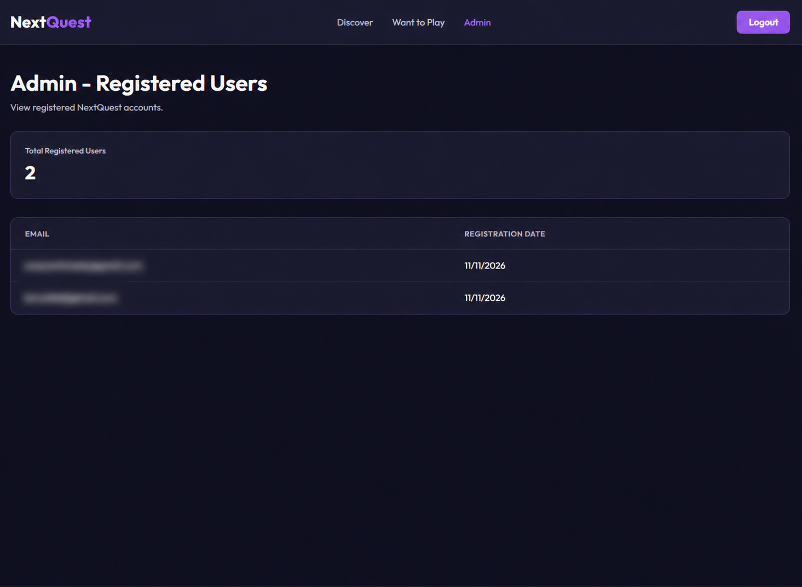
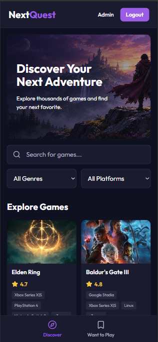

# NextQuest

NextQuest is a responsive video game discovery application built with React, the IGDB API, and Supabase. It allows users to discover games, search by title, filter by genre and platform, view detailed game information, and maintain a personal Want to Play list.

The application addresses the need for a simple way to explore video games and keep track of titles users are interested in playing. It combines a curated selection of popular games with access to the broader IGDB catalog.

NextQuest includes account registration, login, persistent user-specific wishlists, protected routes, and a read-only administrator dashboard.

## Live Application

NextQuest is deployed on Vercel.

**Live Site:** https://nextquest-o8ec0osi1-classwork1.vercel.app/

**GitHub Repository:** https://github.com/KarinBrun/nextquest

## Features

- **Game Discovery:** Browse a curated collection of 20 popular PC and console games.

- **Game Search:** Search the IGDB catalog by game title.

- **Genre and Platform Filters:** Narrow game results using genre and platform selections.
- **Game Sorting:** Sort displayed games by default order, name (A-Z or Z-A), or newest release date first.

- **Game Details:** View descriptions, ratings, release dates, genres, and supported platforms.

- **User Authentication:** Register, verify an email address, log in, and log out using Supabase Authentication.

- **Persistent Want to Play List:** Save and remove games from a personal wishlist that remains available across sessions.

- **Protected Routes:** Restrict access to personal wishlists and administrator functionality based on authentication status.

- **Administrator Dashboard:** Allow authorized administrators to view registered users and their registration dates.

- **Responsive Design:** Provide desktop and mobile layouts with navigation adapted to different screen sizes.
- **Lazy-Loaded Pages:** Use React.lazy and Suspense to load page components on demand, with Vite code splitting.

- **Error Handling:** Display appropriate messages when authentication, database operations, or API requests fail.

## Technologies Used

### Frontend

- React 19

- Vite

- JavaScript (JSX)

- React Router

- React Context API

- SCSS

- Lucide React

### Backend and Database

- Vercel Serverless Functions

- Supabase Authentication

- Supabase PostgreSQL

- Supabase Row Level Security (RLS)

- IGDB API

- Twitch OAuth 2.0

### Testing and Development

- Vitest

- React Testing Library

- User Event

- ESLint

- Git and GitHub

### Deployment

- Vercel

## Project Structure

```text

nextquest/

├── api/                 # Vercel serverless API endpoints

├── public/              # Public assets

├── src/

│   ├── assets/          # Images and other assets

│   ├── components/      # Reusable React components

│   │   ├── auth/        # Protected routes and admin access

│   │   ├── games/       # Game display components

│   │   └── layout/      # Navigation and layout

│   ├── context/         # Authentication and wishlist state

│   ├── pages/           # Application pages

│   ├── services/        # API integration and Supabase client

│   ├── styles/          # Shared SCSS styles

│   └── test/            # Test configuration

├── eslint.config.js

├── vite.config.js

└── package.json

```

## Getting Started

### Prerequisites

- Node.js and npm

- A Twitch Developer application with a Client ID and Client Secret

- A Supabase project

- Vercel CLI for local development

### Installation

Clone the repository:

```bash

git clone https://github.com/KarinBrun/nextquest.git

cd nextquest

```

Install dependencies:

```bash

npm install

```

### Environment Variables

Create a `.env.local` file in the project root containing:

```env

TWITCH_CLIENT_ID=your_twitch_client_id

TWITCH_CLIENT_SECRET=your_twitch_client_secret

VITE_SUPABASE_URL=your_supabase_project_url

VITE_SUPABASE_PUBLISHABLE_KEY=your_supabase_publishable_key

```

The Twitch credentials are accessed only through serverless functions and are not exposed to the React frontend.

The Supabase URL and publishable key are available to the frontend. Database access is protected using Supabase authentication and Row Level Security policies.

Do not commit `.env.local` or secret credentials to GitHub.

A separate Supabase project must also be configured with the required database tables, authentication settings, RLS policies, and administrator authorization function.

### Run Locally

Start the application using Vercel CLI:

```bash

npx vercel dev

```

Open the local URL displayed in the terminal, typically `http://localhost:3000`.

Vercel CLI runs both the React application and its serverless API endpoints.

## Authentication and Authorization

NextQuest uses Supabase Authentication for account registration, login, logout, and session management.

Users register with an email address and password and must verify their email before signing in.

Supabase provides JWT-based authentication, automatic access-token refreshing, and persistent browser sessions.

Authentication state is managed through React Context, allowing components throughout the application to respond to login and logout events.

### Protected Routes

The Want to Play page requires authentication. Unauthenticated visitors are redirected to the login page.

The Admin Dashboard requires additional authorization. NextQuest checks the authenticated user's administrator status before allowing access.

### Database Security

Supabase Row Level Security policies restrict wishlist records to their owners.

Each user can retrieve, add, and remove only their own saved games.

Administrator privileges are maintained in a separate database table. Registered-user information is retrieved through a database function that verifies administrator authorization.

The administrator dashboard is read-only.

## Security Implementation

NextQuest incorporates several security practices:

- **JWT Authentication:** Supabase manages access tokens, session persistence, and token refreshing.

- **Protected Routes:** Authentication and administrator checks restrict access to protected pages.

- **Row Level Security:** Database policies prevent users from accessing other users' wishlist records.

- **XSS Protection:** React escapes text rendered through JSX. External game descriptions are displayed as text rather than injected HTML.

- **Image URL Validation:** Game cover URLs are restricted to HTTPS images from the expected IGDB image domain.

- **CSRF Risk Reduction:** Supabase database requests use bearer-token authentication rather than relying on automatically attached session cookies. The application does not use cookie-based authentication for its custom API endpoints.

- **Input Validation:** Serverless functions validate game, genre, and platform identifiers and escape search terms used in IGDB queries.

- **Environment Variables:** Twitch credentials are stored in server-side environment variables.

- **Error Handling:** API responses use generic error messages without exposing credentials.

Supabase's browser client stores persistent authentication sessions in browser storage. Because JavaScript can access this storage, preventing XSS remains an important security consideration.

## API Integration

NextQuest retrieves video game information from the IGDB API.

Vercel serverless functions handle Twitch authentication and communicate with IGDB. The React frontend requests game data through these endpoints instead of directly accessing IGDB.

### API Endpoints

\| Endpoint | Purpose |

\|---|---|

\| `/api/games` | Retrieve curated games or search and filter the IGDB catalog |

\| `/api/game` | Retrieve detailed information for a specific game |

\| `/api/genres` | Retrieve available game genres |

\| `/api/platforms` | Retrieve available gaming platforms |

Game data is normalized before being displayed in React components.

The normalization process prepares ratings, release dates, descriptions, genres, platforms, and cover image URLs.

API requests include error handling for failed responses and unavailable games.

## Testing

NextQuest uses Vitest and React Testing Library for automated testing.

The current test suite contains **44 passing tests**.

Tests cover:

- Game card functionality

- Wishlist additions, removals, and duplicate prevention

- Game data normalization

- Image URL validation

- API requests and response handling

- Search parameter encoding

- API errors and missing games

- User registration and login

- Authentication errors and state changes

- Logout behavior

- Protected route redirects

- Administrator authorization

- Database errors during administrator verification
- Sorting dropdown options and selection changes
- Default, alphabetical, and newest-first game ordering
- Verification that changing sort order does not trigger another game API request

Supabase and API requests are mocked in unit tests to verify application behavior without relying on external services.

Authentication, wishlist persistence, and administrator access have also been manually tested using the deployed application.

### Run Tests

```bash

npm run test -- --run

```

### Run ESLint

```bash

npm run lint

```

### Create a Production Build

```bash

npm run build

```

The application has successfully passed all three checks.

## Deployment

NextQuest is hosted on Vercel and connected to its GitHub repository.

Changes pushed to the main branch trigger production deployments.

### Production Configuration

The following environment variables must be configured in Vercel:

```env

TWITCH_CLIENT_ID

TWITCH_CLIENT_SECRET

VITE_SUPABASE_URL

VITE_SUPABASE_PUBLISHABLE_KEY

```

Twitch credentials are used exclusively by serverless functions.

Supabase environment variables are included in the frontend build as required for client-side authentication.

Production deployment uses Vite's build process and Vercel's serverless function support.

## Application Screenshots

### Discover Page



### Game Details



### Want to Play List



### Login Page



### Administrator Dashboard



### Mobile Layout



## Known Limitations and Future Enhancements

NextQuest was developed as a React course project, with an emphasis on authentication, API integration, responsive design, security, and testing.

Potential future improvements include:

- Additional game discovery options and more sorting criteria

- Custom user profiles

- Wishlist organization and categories

- Improved loading states and error recovery

- Further automated testing, including additional integration scenarios

- Further performance improvements and loading-state refinements

- Additional accessibility improvements

Game availability and search results depend on the external IGDB API.

## Author

**Karin Brun**

- Portfolio: https://karinbrun.name

- GitHub: https://github.com/KarinBrun
